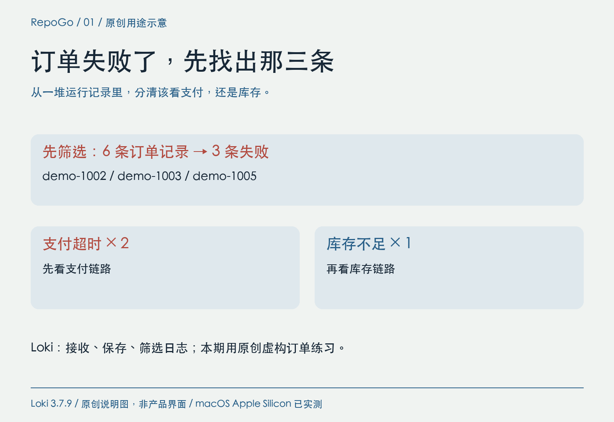
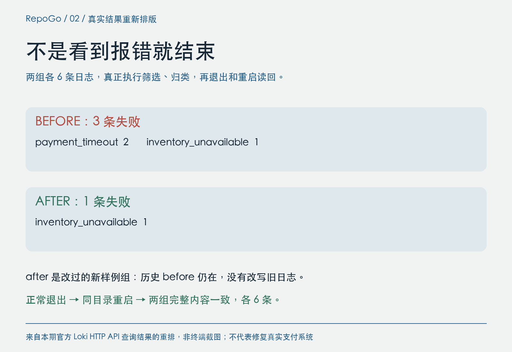
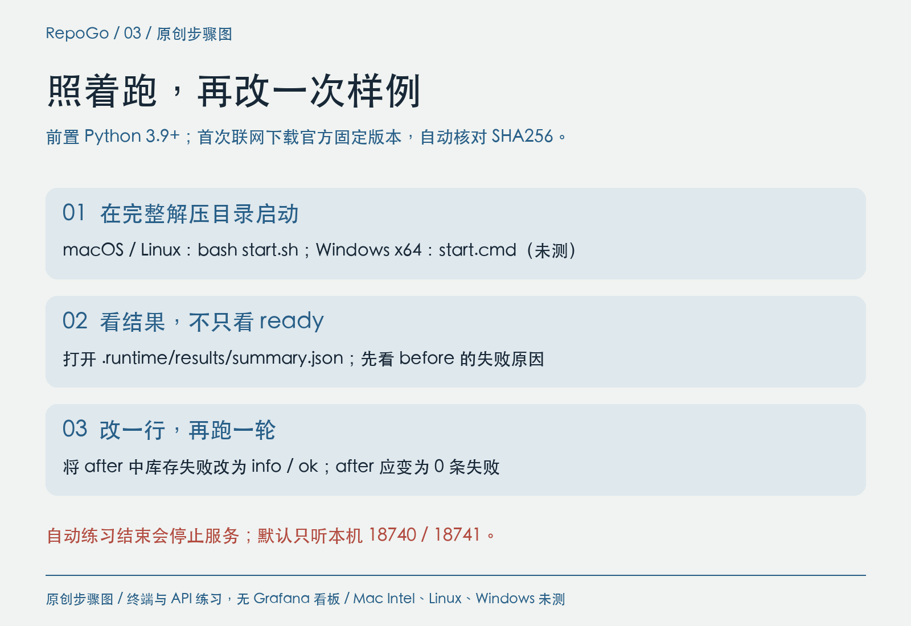

# 订单失败了，先从日志里找到那三条

一次演练：六个订单里三个失败。你先找出失败订单，再发现其中两个都指向支付超时，另一个是库存不足。真正有用的不是一片红色的 error，而是知道下一步该看支付链路，还是库存链路。

这份练习使用 Grafana Loki 3.7.9。它负责接收、保存和查询日志；“日志”就是程序运行时留下的文字记录。我们用自己的虚构订单复现筛选和归类，不连接任何商店，不处理真实交易，也不需要模型或云服务账号。



## 先准备这些

完整解压附件，或克隆本项目 Gitee 交付仓库；不要只下载启动文件。需要 Python 3.9+、可访问 GitHub 官方发行包的网络、可写目录，以及连续两个空闲端口，默认 18740/18741。首次下载本机对应的官方 Loki 归档；本次 Mac ARM64 包约 41MB。数据会持续占用磁盘，练习不是资源限额或生产容量测试。官方开源本地运行无本练习要求的 API 费用，设备和网络成本自负。

本期实际测过 macOS Apple Silicon。Mac Intel、Linux x64/ARM64、Windows x64 的入口已整理但未实测；Windows ARM64 未适配本入口，不能据此承诺虚拟机 x64 仿真能跑。

## 运行完整练习

在本目录打开终端：

macOS / Linux：
```bash
bash start.sh
```

Windows x64：双击 `start.cmd`，或在终端运行 `py -3 run.py`。PowerShell 也可用 `powershell -File .\start.ps1`；如本机策略拒绝脚本，直接运行 Python 命令，不要修改执行策略。

它会从 Grafana 官方固定发行版下载并校验程序，生成仅监听本机的配置，写入两组各六条演示记录，查询、归类、停止、重启，再逐条核对读回内容。最后自行停止服务。看到这句才是整套练习通过：

> 通过：失败记录3→1；重启后before 6条、after 6条完整内容一致。服务已停止。

结果保存在 `.runtime/results/`，总表是 `summary.json`。如果显示“未完成”，不要只凭下载成功就算跑通，见 [FAQ](FAQ.md)。



## 结果里最值得看的三处

`before-errors.json` 能读到 demo-1002、demo-1003、demo-1005 三个失败订单；`before-counts.json` 将它们分成支付超时2次、库存不足1次。后者不是另写一段 Python 替你凑的数，而是 Loki 自己执行查询得到的统计。

`after-errors.json` 只剩 demo-1003，原因仍为库存不足。这里的 after 是另一组新写入的样例：我们把两个支付超时样例改成成功，再让 Loki 查询。它既没有修改历史日志，也不能证明真实支付系统已经修复。

最后打开 `before-after-restart.json`、`after-after-restart.json`：程序真正退出再启动同一个数据目录，两组各六条记录的完整内容均读回一致。这个检查只证明本次本机正常退出的持久化，不等于断电恢复、集群容灾或长期留存验证。

## 自己改一次，才算会用

先备份 `samples/after.jsonl`，把 demo-1003 的 `level` 从 `error` 改为 `info`，将 `reason` 改为 `ok`，再运行相同入口。after 应变为0个失败，统计结果为空；before 仍是三条。检查 `summary.json` 的 `scenarios.after.error_orders` 是否为 `[]`。本包自动验收按输入样例计算预期，因此允许这样的实验。

每次运行会生成新的 run 标记，查询只看本轮。旧记录仍在本机数据目录里；“本轮看不到”不等于被删除。不要把订单号、每次变化的 run 当作流标签：本例只用应用、环境、阶段作低数量标签，订单和 run 留在 JSON 内容里。



继续阅读：[手动启动、查询、停止与备份](DEPLOY.md) · [常见问题](FAQ.md) · [来源与许可](ATTRIBUTION.md)。本包提供中文入口、样例、校验和讲解；没有修改 Loki 源码，也没有做完整界面汉化。它没有打包 Grafana 看板或自动采集器，默认是终端/API练习。
